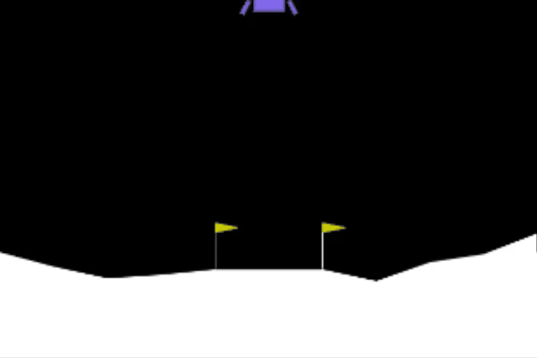

<div align="center">

# 🚀 LunarLander PPO

### Teaching a spacecraft to land itself, one crash at a time

<br>


<br>

*No rules. No hand-written controller. Just a reward signal and a million steps of trying again.*

<br>

[](https://colab.research.google.com/github/zeynpakn/LunarLander-PPO-Reinforcement-Learning/blob/main/LunarLander_PPO.ipynb)
[](https://huggingface.co/zeynpakn/ppo-LunarLander-v2)

<br>

<!-- Save your recording as assets/demo.gif -->
<a href="https://colab.research.google.com/github/zeynpakn/LunarLander-PPO-Reinforcement-Learning/blob/main/LunarLander_PPO.ipynb">
  
</a>

<sub>👆 Click the demo to open the notebook in Google Colab</sub>

</div>

---

## 📖 Overview

This project trains a PPO agent to land the spacecraft in Gymnasium's `LunarLander-v2`. The agent is given no rules, only a reward signal: points for approaching the pad and touching down softly, penalties for burning fuel and crashing.

It was built for the [Hugging Face Deep RL Course, Unit 1](https://huggingface.co/learn/deep-rl-course/unit1/introduction), and the trained model is published on the [Hugging Face Hub](https://huggingface.co/zeynpakn/ppo-LunarLander-v2).

## 🌙 Environment

Each step, the agent observes the state, picks an action, and receives a reward:

```
Observation  →  Action  →  Reward  →  Next Observation
```

**Observation (8 values):** position, velocity, angle, angular velocity, and a contact flag for each landing leg.

| Action | Meaning |
| :----: | ------- |
| 0 | Do nothing |
| 1 | Fire left orientation engine |
| 2 | Fire main engine |
| 3 | Fire right orientation engine |

## ⚙️ Training

Trained with Stable-Baselines3 on Google Colab. With 16 parallel environments and 1,024 steps each, every rollout collects 16,384 samples. PPO then runs 4 epochs of minibatch updates (batch size 64) on that rollout, which comes to roughly 61 policy updates over 1M timesteps.

| Parameter | Value | What it does |
| --------- | ----- | ------------ |
| Policy | `MlpPolicy` | SB3's default MLP actor-critic (two hidden layers of 64 units) |
| `n_envs` × `n_steps` | 16 × 1,024 | Rollout size per update; more parallel environments give less correlated samples |
| `batch_size` | 64 | Minibatch size for each gradient step |
| `n_epochs` | 4 | Passes over each rollout before collecting new data |
| `gamma` (γ) | 0.999 | Discount factor; a high value keeps the final landing reward relevant across long episodes |
| `gae_lambda` | 0.98 | Bias/variance trade-off in the advantage estimate |
| `ent_coef` | 0.01 | Entropy bonus that keeps the policy exploring |

## 📊 Results

| Metric | Random agent | Trained PPO agent |
| ------ | -----------: | ----------------: |
| Mean reward | -280.50 | **+250.74** |
| Episodes | 1 | 10 |
| Std deviation | — | 23.30 |
| Mean − Std | — | **227.44** |

> The random baseline is a single episode and the PPO result is averaged over 10, so this is an illustration, not an identically sampled benchmark.

The course scores a model by mean reward minus standard deviation, and Unit 1 requires at least 200. This model scored 227.44 locally and 219.19 on Hugging Face ✅

## ▶️ Run It

Open the notebook with the **RUN ON COLAB** button above and run all cells. It installs the dependencies, trains and evaluates the agent, and records a gameplay video.

## 🎓 What I Learned

- An agent only learns what the reward teaches it, so the reward is the whole game
- PPO takes small, careful steps instead of big risky ones, and that is why training stays stable
- One lucky landing proves nothing, so evaluate over many episodes
- Training a model is half the job; sharing it on the Hub is the other half

---

<div align="center">

**Project by [zeynpakn](https://github.com/zeynpakn)**

*One small step for an agent, one giant leap for reinforcement learning. 🌙*

</div>